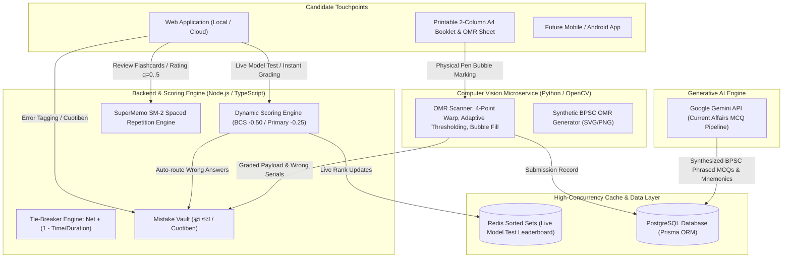

# 🇧🇩 BCS & BD Competitive Exam Prep Engine
### Production-Grade Architecture & Science-Backed Learning Platform

An enterprise-grade EdTech platform architected specifically for Bangladesh competitive examinations (**BCS Preliminary, Primary Assistant Teacher, Combined Bank Officer & Cash, and BJS Judiciary**). 

The platform synthesizes evidence-based cognitive learning systems (**SuperMemo SM-2 Spaced Repetition, Active Recall Flashcards, Mistake Vault / ভুল খাতা / Cuotiben**) with real-world physical examination workflows (**Printable 2-Column BPSC Booklets + Computer Vision OMR Scanner**) and generative AI (**Google Gemini 1.5 MCQ Synthesis**).

---

## 🏛️ System Architecture



---

## 📦 Key Deliverables Included

| Deliverable | Location | Description |
| :--- | :--- | :--- |
| **1. Prisma Schema** | [`prisma/schema.prisma`](file:///Users/mohiuddin/Documents/antigravity/adventurous-archimedes/prisma/schema.prisma) | Complete production schema defining 10 models (`User`, `Exam`, `Subject`, `Topic`, `Question`, `UserMistakeVault`, `UserSpacedReview`, `ExamSubmission`, `CurrentAffairsMCQ`, `OMRScanLog`) with relations, enums & composite indexes. |
| **2. OpenCV OMR Pipeline** | [`omr-service/omr_scanner.py`](file:///Users/mohiuddin/Documents/antigravity/adventurous-archimedes/omr-service/omr_scanner.py) | 4-point perspective warp, Otsu thresholding, bubble grid extraction, BPSC dynamic negative penalty, and Mistake Vault integration. |
| **3. Node.js & TypeScript Services** | [`src/services/`](file:///Users/mohiuddin/Documents/antigravity/adventurous-archimedes/src/services/) | Redis Sorted Set Leaderboard, SuperMemo SM-2 Spaced Repetition calculation, and BPSC Exam Synthesizer with 10-year official weightages. |
| **4. Gemini AI Pipeline** | [`src/services/gemini-pipeline.service.ts`](file:///Users/mohiuddin/Documents/antigravity/adventurous-archimedes/src/services/gemini-pipeline.service.ts) | Senior BPSC Question Setter prompt engineering template, strict JSON schema output, authentic Bengali distractor generation & mnemonic rhythm synthesis. |
| **5. Full Local Web Application** | [`src/web/server.js`](file:///Users/mohiuddin/Documents/antigravity/adventurous-archimedes/src/web/server.js) & [`src/web/public/`](file:///Users/mohiuddin/Documents/antigravity/adventurous-archimedes/src/web/public/) | Complete interactive local web app running on `http://localhost:3000` with Live Exam Room, Mistake Vault, 3D Flashcards, OMR Simulator, Redis Leaderboard, and Gemini AI. |
| **6. Printable BPSC Paper & OMR** | [`src/web/public/omr-sheet.html`](file:///Users/mohiuddin/Documents/antigravity/adventurous-archimedes/src/web/public/omr-sheet.html) | Authentic 2-column BPSC Question Booklet + Machine-readable OMR sheet with corner alignment finder markers for mobile camera grading. |

---

## 🧮 Mathematical & Algorithmic Formulations

### 1. Tie-Breaking Ranking Formula
In high-stakes exams like BCS, thousands of candidates tie on the exact same net score. To ensure deterministic, fair, real-time rankings:
$$\text{TieBreakerScore} = \text{NetScore} + \left(1 - \frac{\text{TimeTakenSec}}{\text{TotalDurationSec}}\right)$$
* Example: Two candidates both achieve Net Score 145.50 on a 120-minute (7,200s) exam.
  * Candidate A finishes in 45m (2,700s): $145.50 + (1 - 2700/7200) = 145.50 + 0.6250 = \mathbf{146.125000}$
  * Candidate B finishes in 85m (5,100s): $145.50 + (1 - 5100/7200) = 145.50 + 0.2917 = \mathbf{145.791667}$
* In Redis Sorted Sets (`ZADD`), higher score strictly outranks slower submission without secondary queries.

### 2. Dynamic Negative Marking Schemes
* **BCS Preliminary Standard**: $-0.50$ deducted per incorrect answer ($0.5 \times \text{WrongCount}$).
* **Primary Assistant Teacher Standard**: $-0.25$ deducted per incorrect answer ($0.25 \times \text{WrongCount}$).
* **Bank Recruitment Exam**: $-0.25$ deducted per incorrect answer.

### 3. SuperMemo SM-2 Spaced Repetition Algorithm
Recall quality $q \in \{0, 1, 2, 3, 4, 5\}$:
* If $q \ge 3$ (Recall Success):
  * $n = 0 \implies I(1) = 1\text{ day}$
  * $n = 1 \implies I(2) = 6\text{ days}$
  * $n \ge 2 \implies I(n) = \text{round}(I(n-1) \times EF)$
  * Repetition counter: $n = n + 1$
* If $q < 3$ (Recall Failure):
  * $n = 0$
  * $I(1) = 1\text{ day}$
* Easiness Factor ($EF$) Adjustment:
  $$EF' = EF + (0.1 - (5 - q) \times (0.08 + (5 - q) \times 0.02)), \quad EF' \ge 1.3$$

### 4. BPSC Official 200-Mark Preliminary Weightages
1. বাংলা ভাষা ও সাহিত্য: **৩৫** (ভাষা: ১৫, সাহিত্য: ২০)
2. English Language & Literature: **৩৫** (Grammar: ২০, Literature: ১৫)
3. বাংলাদেশ বিষয়াবলী: **৩০** (সংবিধান, মুক্তিযুদ্ধ, অর্থনৈতিক সমীক্ষা ও বাজেট)
4. আন্তর্জাতিক বিষয়াবলী: **২০** (বৈশ্বিক ভূরাজনীতি, নিরাপত্তা পরিষদ, পরিবেশ চুক্তি)
5. গাণিতিক যুক্তি: **১৫** (শতকরা, লাভ-ক্ষতি, ধারা, বিন্যাস-সমাবেশ, জ্যামিতি)
6. মানসিক দক্ষতা: **১৫** (যুক্তি, সম্পর্ক, ভাষাগত দক্ষতা)
7. সাধারণ বিজ্ঞান: **১৫** (মানবদেহ, আলো, পদার্থ, রোগপ্রতিরোধ)
8. কম্পিউটার ও তথ্যপ্রযুক্তি: **১৫** (নেটওয়ার্কিং, IPv4/IPv6, ক্লাউড, ডেটাবেস)
9. ভূগোল, পরিবেশ ও দুর্যোগ ব্যবস্থাপনা: **১০**
10. নৈতিকতা, মূল্যবোধ ও সুশাসন: **১০**
**Total: ২০০ নম্বর | ২০০ প্রশ্ন | ১২০ মিনিট**

---

## 🚀 How to Run Locally

### 1. Launch the Local Web Application
The web application is standalone and runs on native Node.js:
```bash
npm start
# or
node src/web/server.js
```
Open your browser at:
* **Web Application**: [http://localhost:3000](http://localhost:3000)
* **Printable 2-Column Booklet & OMR**: [http://localhost:3000/omr-printable](http://localhost:3000/omr-printable)

### 2. Run Algorithmic Verification Test Suite
```bash
npm test
# or
node tests/test-suite.js
```

### 3. Test OpenCV Computer Vision OMR Pipeline
```bash
# Generate synthetic vector BPSC OMR sheet
python3 omr-service/generate_test_omr.py

# Run OMR bubble recognition & mistake extraction
python3 omr-service/omr_scanner.py
```

### 4. Run with Docker Compose (Postgres + Redis + OMR Service + Web App)
```bash
docker compose up -d
```

---

## Live Scheduled Exams & Merit List (মেধা তালিকা)

| Page | Who | What |
|------|-----|------|
| `/admin` | Admin | Announce an exam: question set, start time, duration, negative mark, notice. See registrations, live progress, merit list, CSV export. |
| `/live` | Students | Upcoming / live / finished exams with countdown. Register with name + mobile, enter the hall when it starts, see result & merit list after it ends. |
| `/exam-hall?live=<id>` | Students | The same 2-column question paper + OMR, driven by the server clock. Auto-submits at the end. |

- Admin key: set `ADMIN_KEY` (default `admin123`, change it before going public).
- Data is stored in `data/live-exams.json` (override with `LIVE_DATA_FILE`), so a restart keeps exams and results.
- The answer key never reaches the browser until the exam has ended. Each OMR bubble is autosaved, so a refresh or a dropped connection resumes where the candidate was.
- Time taken is measured on the server from the official start time. Ranking: Net Score first, then the tie-breaker `1 - Time_Taken / Total_Duration` among equal net scores (equal score and time share a rank).
- Re-registering with the same mobile number returns the same candidate, so a student can continue on another device.
- API lives in `src/web/live-exam.js` (`/api/live/...`).
